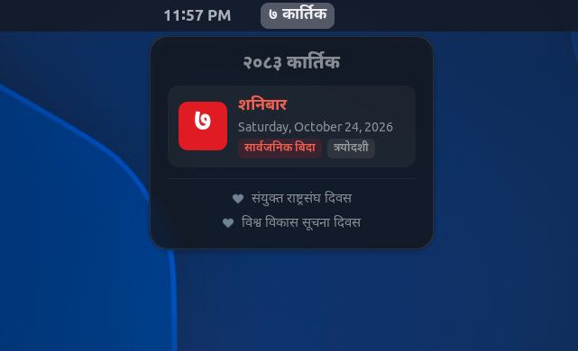

# Nepali Calendar GNOME Shell Extension (`nepali-calendar@sanghaarsha.github.com`)

A modern GNOME Shell extension that provides a native Bikram Sambat (BS) Nepali calendar in the top panel with a Libadwaita hero card popup, dual English/Nepali dates, holiday and weekend highlights, and lunar Tithi details.

> **Note**: This project is a modernized fork of [PublisherName/nepali-calendar-gs-extension](https://github.com/PublisherName/nepali-calendar-gs-extension) originally created by **Subash Ghimire** ([@PublisherName](https://github.com/PublisherName)).

<p align="center">
  
</p>

## Features

- **Libadwaita Hero Card Popup**: Clean, modern popover featuring an accent-styled date tile, weekday, Gregorian full date, lunar Tithi badge, public holiday indicator (`सार्वजनिक बिदा`), and upcoming festivals list.
- **Configurable Top Panel Indicator**: Supports `Full` (e.g. `७ कार्तिक (शनिबार)`), `Medium` (`७ कार्तिक`), or `Date Only` (`७`) formats, with optional calendar icon and year display.
- **Customizable Numeral Systems**: Seamlessly switch between Devanagari numerals (`०, १, २, ३...`) and Western digits (`0, 1, 2, 3...`) across the top panel and popup card.
- **Dual-Date Display**: Shows both Bikram Sambat (BS) and Gregorian (AD) calendar dates.
- **Holiday & Weekend Highlights**: Highlights official public holidays and Saturdays in both the top bar and popup card.
- **Lunar Tithi & Festivals**: Displays the current lunar Tithi and Nepali cultural festivals/events.
- **Native GNOME Theme Fidelity**: Seamlessly adapts to light, dark, and custom themes (e.g., Catppuccin, Adwaita) and respects system accent colors.
- **Libadwaita Preferences**: Modern settings window for customizing display format, panel position (`Left`, `Center`, `Right`), and feature toggles.

## Planned Features

- [ ] **English / Nepali Language & Script Toggle**: Option to toggle month and weekday names between Devanagari script (e.g. `कार्तिक`, `आइतबार`) and Romanized English (e.g. `Kartik`, `Sunday`).
- [ ] **Quick Copy Date to Clipboard**: Click on the date tile to copy today's formatted Nepali date (e.g. `२०८१-०७-०७` or `७ कार्तिक २०८१`) directly to clipboard.
- [ ] **Upcoming Holidays & Festivals Preview**: Advance preview of public holidays and festivals coming up in the next 7–14 days.
- [ ] **Built-in BS ⟷ AD Date Converter Tool**: Integrated date conversion page inside the Libadwaita Preferences window for quick two-way Bikram Sambat and Gregorian conversion.
- [ ] **Holiday Morning Notifications**: Optional morning desktop notifications for official public holidays and major festivals.
- [ ] **Lunar Phase Symbolic Icons**: Dynamic moon phase symbolic icons (Purnima 🌕, Aunsi 🌑, etc.) displayed alongside the lunar Tithi badge.
- [ ] **Extended Year Range Coverage**: Expansion of the calendar dataset beyond BS 2085.

## Installation

### Manual Installation
1. Clone this repository:
   ```bash
   git clone git@github.com:sanghaarsha/nepali-calendar-gse.git
   ```

2. Change directory into the repository:
   ```bash
   cd nepali-calendar-gse
   ```

3. Run the install script:
   ```bash
   ./install.sh
   ```

4. Enable the extension:
   ```bash
   gnome-extensions enable nepali-calendar@sanghaarsha.github.com
   ```

## Development & Packaging

1. Install dependencies:
   ```bash
   uv sync
   ```

2. Build extension zip:
   ```bash
   ./build.sh
   ```

3. Validate with shexli:
   ```bash
   uv run shexli nepali-calendar@sanghaarsha.github.com.zip
   ```

4. Open preferences:
   ```bash
   gnome-extensions prefs nepali-calendar@sanghaarsha.github.com
   ```

## Credits & Acknowledgements

- **Original Author**: [Subash Ghimire](https://github.com/PublisherName) ([@PublisherName](https://github.com/PublisherName)) for creating the original [Nepali Calendar GNOME Shell Extension](https://github.com/PublisherName/nepali-calendar-gs-extension) and compiling the Bikram Sambat calendar dataset.
- **Original Extension**: Available on [extensions.gnome.org (EGO #7490)](https://extensions.gnome.org/extension/7490/nepali-calendar/).
- **Current Maintainer**: [Sangharsha Dahal](https://github.com/sanghaarsha) ([@sanghaarsha](https://github.com/sanghaarsha)).

## License
This project is licensed under the GNU General Public License v3.0 - see the [LICENSE](LICENSE) file for details.
